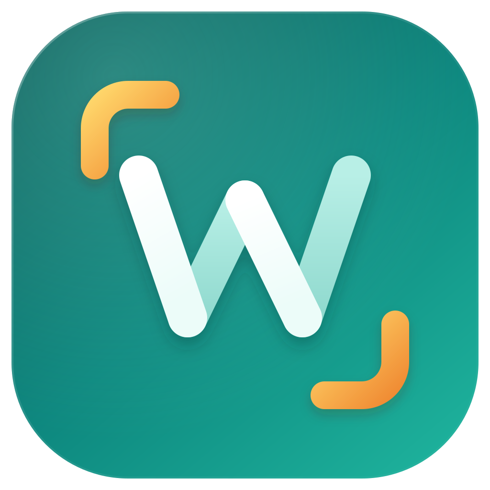
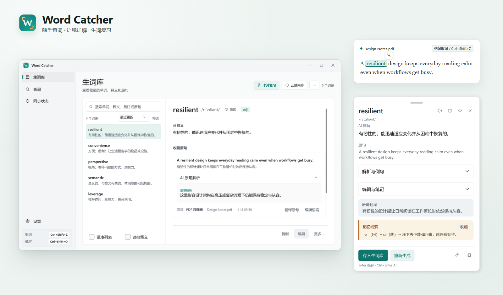
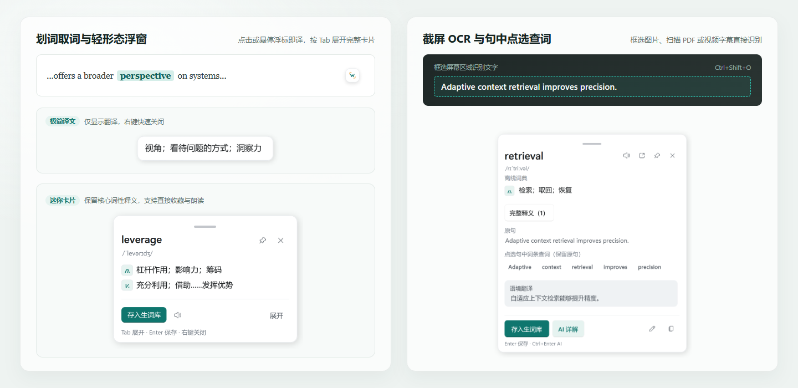
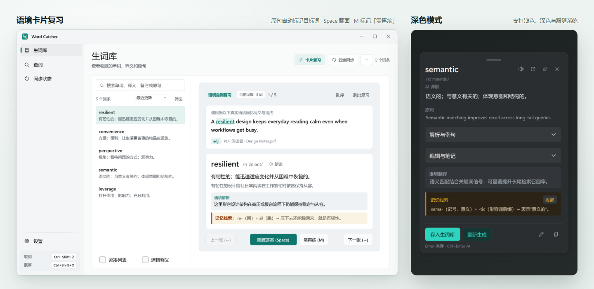

  
  <h1>Word Catcher</h1>
  
面向日常阅读与学习的 Windows 跨应用查词与语境生词库工具。

  
<a href="https://github.com/qup1010/WordCatcherDesktop/releases">下载安装</a> · <a href="https://github.com/qup1010/WordCatcherDesktop/issues">反馈问题</a>

**Word Catcher** 是一款用于 PDF 文献、文档阅读与日常浏览的 Windows 查词与生词整理工具。选中单词、短语或句子即可就地查词或获取 AI 语境详解，将词汇连同所在原句和笔记存入本地词库，并支持卡片复习、WebDAV 同步与 Anki 联动制卡。

## 主要功能

### 1. 随时取词与多种浮窗形态

- **全局快捷键取词**：在任意窗口选中单词、短语或句子，按下 `Ctrl+Shift+Z`（可自定义）即可在光标旁弹出查词浮窗；主窗口内也提供「查词」页支持手动输入查询，输入英文前缀时自动提供离线词典候选补全。
- **鼠标划词取词（可选）**：开启后拖选或双击文本即可显示迷你 `W` 浮标（支持悬停自动展开迷你卡片、划中英文直接出译文，或右键浮标快捷屏蔽当前应用）。
- **截屏 OCR 取词**：按下 `Ctrl+Shift+O`（可自定义）框选图片、扫描版 PDF 或视频字幕区域即可识别文字，识别后可直接点击句中任意词条查词并保留原句上下文。
- **三种浮窗形态**：支持在设置中选择「极简译文」「迷你卡片」或「完整卡片」作为默认形态，按 `Tab` 可展开完整卡片，点击图钉固定浮窗后可保留位置并连续更新取词结果。

### 2. 离线词典、在线快译与 AI 详解

| 查词方式 | 内容与特性 | 使用说明 |
| --- | --- | --- |
| **离线词典** | 包含音标、词性分组释义、补充解释、记忆线索与例句 | 在「设置 → 查词与词典」一键下载或导入本地词典后，查词无需联网 |
| **在线快译** | 支持微软翻译、谷歌翻译与 B 站 Index-Translate，自动故障转移 | 未命中离线词典或输入整句时自动调用 |
| **AI 详解** | 结合当前原句流式生成语境释义、整句翻译、核心表达与用法提示 | 需配置兼容 OpenAI 格式的接口与密钥，内置常见模型服务商预设 |

- **中英自动互译**：选中中文时自动翻译为英语，外文内容输出为目标语言（默认简体中文）。
- **语音朗读**：支持美式、英式或跟随系统默认语音朗读，并可在设置中按需开启在线真人发音（默认关闭）。

### 3. 语境生词库与卡片复习

- **多语境收藏与整理**：同一词条可关联来自不同文档和窗口的多条原句与来源信息，支持按单词、释义、备注、原句实时搜索，按收藏时间、同步状态或来源应用筛选排序，以及紧凑列表和遮挡释义。
- **语境卡片复习**：在「生词库」点击「卡片复习」（支持多选特定词条或按当前筛选范围复习），系统会在原句中自动标出当前复习的目标词，支持乱序、翻面查看释义与语境解析、语音朗读，以及按 `M` 标记「需再练」并在本轮结束后集中重练。
- **主题外观**：支持浅色、深色与跟随 Windows 系统外观。

### 4. 云端同步、备份与 Anki 联动

- **WebDAV 同步**：支持配置 HTTPS WebDAV 服务在多台设备间同步词库与学习记录；发生并发修改冲突时可逐条对比并选择保留版本。
- **Anki 自动制卡（可选）**：对接本机 [AnkiConnect](https://ankiweb.net/shared/info/2055492159)（默认牌组 `Word Catcher`），支持目标词上下文挖空与离线排队重试。
- **JSON 备份**：支持在「生词库」导出与导入全部词条和语境的完整 JSON 备份。

## 安装与上手

运行环境要求：**Windows 10 / 11（64 位 x64）**，安装包已包含所需运行环境，无需额外安装 .NET。

1. 前往 [GitHub Releases](https://github.com/qup1010/WordCatcherDesktop/releases) 下载：
   - **安装版（推荐）**：`WordCatcherDesktop-win-Setup.exe`，支持自定义安装路径与后续自动沿用目录覆盖升级。
   - **便携版**：`WordCatcherDesktop-win-Portable.zip`，解压后直接运行 `WordCatcher.App.exe`。
2. 启动后程序常驻系统托盘，双击托盘图标即可打开主窗口。
3. 推荐首次使用顺序：在「设置 → 查词与词典」安装离线词典，按需在「设置 → AI 详解」配置模型接口，随后在任意阅读窗口选中英文单词按 `Ctrl+Shift+Z` 即可体验。

更多安装与升级细节见 [安装与升级说明](docs/installation-and-updates.md)。

## 常用快捷键

| 场景 | 快捷键 | 作用 |
| --- | --- | --- |
| 全局（其他应用） | `Ctrl+Shift+Z` | 读取当前选中文本并弹出查词浮窗 |
| 全局（其他应用） | `Ctrl+Shift+O` | 框选屏幕区域进行截屏 OCR 取词 |
| 查词浮窗 | `Tab` / `Esc` | 展开完整卡片 / 关闭浮窗 |
| 查词浮窗 | `Enter` / `Ctrl+Enter` | 存入生词库 / 触发 AI 详解 |
| 查词浮窗 | `Ctrl+P` / `Ctrl+C` | 固定或取消固定浮窗 / 复制词条与释义 |
| 卡片复习 | `Space` / `P` | 显示或隐藏答案 / 朗读当前词条 |
| 卡片复习 | `←`、`→` / `M` / `Esc` | 上一张、下一张 / 标记「需再练」 / 退出复习 |
| 主窗口 | `Ctrl+1` ~ `4` / `Ctrl+F` / `Ctrl+S` | 切换页面 / 聚焦搜索或查词框 / 保存修改 |

## 数据与隐私

- 词库、设置与查询历史均保存在本地（`%LocalAppData%\WordCatcher\`），命中离线词典时不发起外部网络请求。
- 仅在触发在线快译、AI 详解或手动开启在线真人发音时，向对应服务发送当前待查文本与必要的上下文。
- API Key 与 WebDAV 密码仅在本机通过 Windows 凭据加密保存，不会随 WebDAV 同步文件上传。

## 常见问题

- **按下快捷键无反应或未取到文本**：确认快捷键未被其他软件占用；遇到禁用复制的阅读器、图片或扫描件时，可使用截屏 OCR（`Ctrl+Shift+O`）或在主窗口「查词」页手动输入。
- **测试 AI 连接通过但生成详解失败**：确认所选模型支持结构化 JSON 输出且模型名与额度正常；使用本地 Ollama 时需确认对应模型已拉取并处于运行状态。
- **Anki 卡片停留在待同步**：确认 Anki 已启动且已安装 [AnkiConnect](https://ankiweb.net/shared/info/2055492159) 附加组件（代码 `2055492159`）并重启过 Anki，之后在「同步状态」页点击重试即可。

## 文档与数据致谢

- 开发构建说明与技术文档见 [开发说明](docs/development.md) 与 [文档索引](docs/README.md)。
- 离线词典数据来自 [Open Dictionary](https://github.com/ahpxex/open-dictionary)（包含来自 English Wiktionary 及其贡献者与 Wiktextract 的数据），按 [CC BY-SA 4.0](https://github.com/ahpxex/open-dictionary/blob/main/LICENSE-DATA.md) 授权。
